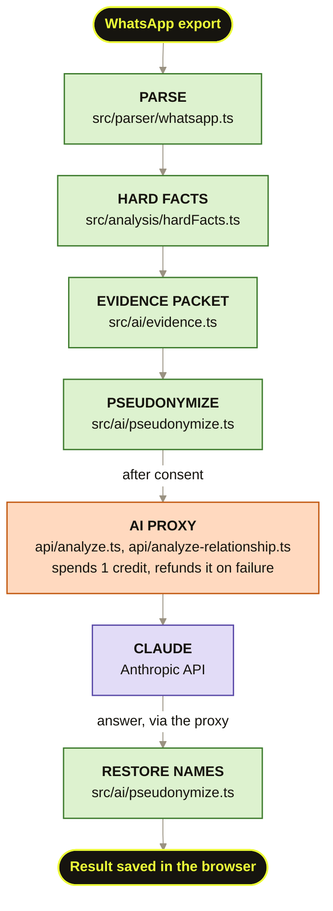
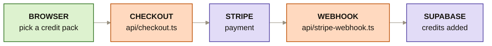

<!-- Owner: @awyttrinx (documentation). Last checked against the code: 19 Nov 2026. -->

# About tea: how it works and why

This document explains how tea turns a WhatsApp chat into statistics and AI reads, and why it is built the way it is. It is for developers and reviewers who want to understand the design before they read the code. It answers "what" and "why". For "how do I", see [Getting started](getting-started.md) and [Contributing](CONTRIBUTING.md).

After reading it you will know:

- which parts of tea run in the browser, which run on a server, and which are outside services
- what happens to a chat from upload to the finished read
- which design rules shape the code, and what they cost

## What tea is

tea is a web app that reads an exported WhatsApp chat and shows two things:

- **Hard Facts:** statistics about the chat, like who writes more, who replies faster, who starts conversations and when people are active. tea counts them in the browser. No AI is involved.
- **AI reads:** a **Profile** of you, and for chats with exactly two people a **Relationship** read about the dynamic between you. An AI model writes them from a pseudonymized sample of the chat, only after you agree.

The app lives in the `roentgen/` folder. "Röntgen" (x-ray) was the working title. The product name is tea.

## Background: three rules behind the design

Most design decisions in tea come from three rules. If a part of the code looks unusual, one of these rules is usually the reason.

1. **The chat stays on the device.** Parsing, statistics and charts all run in the browser. A server only sees data when the user starts an AI read and agrees on the consent screen, and even then it gets a sample, not the whole chat.
2. **No real names reach the model.** Before anything leaves the browser, names become `Person A`, `Person B` and so on, and phone numbers, emails and links are removed. The browser puts the real names back into the answer.
3. **The app works without an API key.** By default it runs in fixture mode and loads sample results from `public/fixtures/`. A new developer can run the whole app without an account, a key or a payment.

## How a chat moves through tea

The diagram shows the path of a chat for an AI read. Green steps run in the browser, orange runs on tea's server, purple is an outside service.

| Step | What happens | Why it is done this way |
|---|---|---|
| Parse | `src/parser/whatsapp.ts` turns the export into a list of messages. It understands German and English date formats, drops system notices like "created group", and merges name variants like `Max` and `Max Müller`. | Pure function, no network. The raw chat is never sent anywhere. |
| Hard Facts | `src/analysis/hardFacts.ts` goes through the messages once and counts per person: share of messages, reply times, who starts after a silence of 4 hours or more, late-night messages (23:00 to 04:59), and runs of 3 or more messages in a row. | Facts, not opinions. The same chat always gives the same numbers, so this part needs no AI. |
| Evidence packet | `src/ai/evidence.ts` builds the input for the model: the statistics, a set of notable moments, and a sample of whole conversations picked by `src/ai/sampling.ts`. | The model interprets numbers that are already counted. It does not count itself, so it cannot invent a statistic. |
| Pseudonymize | `src/ai/pseudonymize.ts` replaces names with `Person A`, `Person B`. For a Profile it also replaces pronouns with the name. | Rule 2. The pronoun step stops the model from guessing a gender the chat does not show. |
| AI proxy | `api/analyze.ts` (Profile) and `api/analyze-relationship.ts` (Relationship) check the user, spend one credit, send the packet to Anthropic with the server's API key, and refund the credit if the call fails. | The API key must never reach the browser. The proxy does not log request bodies and keeps the packet only for the length of the call. |
| Claude | The model (by default `claude-haiku-4-5`) writes the read as structured JSON. The Relationship read is split into three parts that run at the same time. | A fast, small model keeps the cost of one read low. Three parallel parts keep the Relationship read under the server time limit. |
| Restore names | `restoreNamesDeep` in `src/ai/pseudonymize.ts` puts the real names back into the answer. | The user sees real names. Anthropic never did. |
| Save | The result is saved in the browser: chats and results in IndexedDB, the list of chats in `localStorage`. | Rule 1. No chat and no result is stored on a server. |

## How payments work

Credits are the only thing tea stores on a server. A read costs one credit.

1. The user picks a credit pack. `api/checkout.ts` opens a Stripe checkout.
2. After the payment, Stripe calls `api/stripe-webhook.ts`, which adds the credits in Supabase.
3. When a read starts, the AI proxy spends one credit. If the read fails, it refunds the credit.

Every visitor gets an anonymous Supabase session, so people can buy credits without signing up. After the first purchase, tea suggests signing in with Google so the credits survive a cleared browser. The chat itself never appears in the payment flow.

## How the app is organized

`App.tsx` works as a state machine. Each screen is one `Stage`, for example `upload`, `analysis` (the Hard Facts), `consent`, `ai`, `profiles`, `relationship` and `credits`. All moves between screens are calls to `setStage(...)` in `App.tsx`. The [User Flow](README.md#user-flow) in the README shows the same screens from the user's side.

The AI layer can be swapped. `src/ai/analyzer.ts` picks one of two analyzers when the app loads, based on `VITE_ROENTGEN_ANALYZER`:

- `fixture` (default) returns the sample JSON from `public/fixtures/` after a short random delay of 1.6 to 3.2 seconds, so the loading screens look real
- `api` sends real requests through the AI proxy

The rest of the app does not know which analyzer is active.

## What the design means in practice

- **Privacy is built in, not added on.** Because the chat is parsed and summarized in the browser, a server cannot leak what it never receives. The cost is that very large chats depend on the user's device. tea stops at 50 MB.
- **The model sees a sample, not the whole chat.** Reads are faster and cheaper, and the user stays in control of what goes out. The trade-off is that a read can miss something that only appears outside the sample.
- **Fixture mode keeps development cheap.** Anyone can work on the screens without a key or a payment. A change to the AI layer still has to be tested once in `api` mode with a real key.
- **One credit per read, refunded on failure.** The user never pays for a read that did not arrive.

## Summary

tea does almost everything in the browser. Only an AI read leaves the device, only after consent, and only as a pseudonymized evidence packet that goes through tea's own server to Claude. The answer comes back, the browser restores the names, and the result is saved on the device. Payments run separately through Stripe and Supabase and never touch the chat.

## Further reading

- [README](README.md): what tea is, setup, and the user flow
- [Getting started](getting-started.md): run tea locally in about 10 minutes
- [Contributing](CONTRIBUTING.md): privacy rules, code style and pull requests
- [`privacy-audit.md`](../privacy-audit.md), [`dpia.md`](../dpia.md), [`vvt.md`](../vvt.md): privacy and legal documents
- [`tea_konzept.md`](../tea_konzept.md), [`tea_brand_reference.md`](../tea_brand_reference.md): product idea and brand

## Glossary

| Term | Meaning |
|---|---|
| Hard Facts | The statistics tea counts in the browser, without AI |
| Read | An AI analysis: Profile (you) or Relationship (both people in a two-person chat) |
| Evidence packet | The input for the model: statistics, notable moments and a sample of conversations |
| Pseudonym | A placeholder like `Person A` that replaces a real name |
| Proxy | tea's server functions in `api/` that hold the API key and forward requests to Anthropic |
| Fixture mode | The default mode, which uses sample results instead of a real AI |
| Credit | What one read costs. Bought through Stripe, stored in Supabase |
| Stage | One screen in the `App.tsx` state machine |
