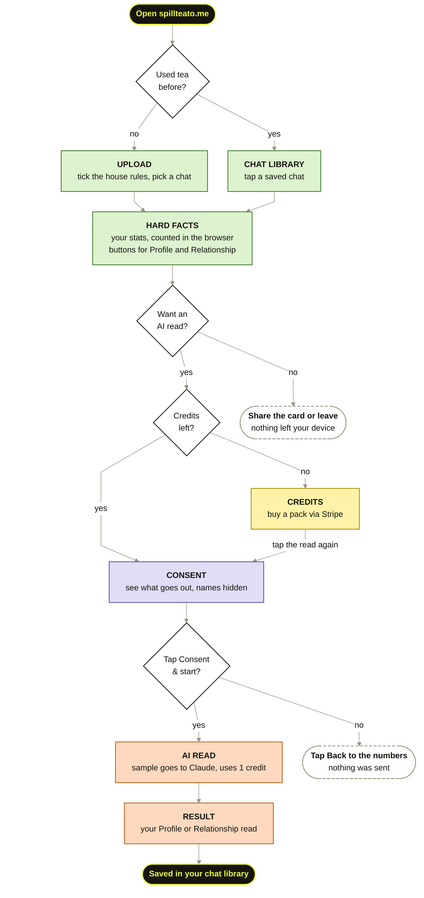

# tea

With tea you can see how you actually talk to someone on WhatsApp: who writes more, who answers faster, who starts the conversation, and at what times you are most active. You upload an exported chat, and the first results appear right away in your browser, without the chat ever leaving your device.

If you want a deeper read of your communication style, you can unlock it. Before anything is sent, tea shows you exactly how many messages leave your device, and names are replaced first.

tea shows patterns, not advice and not scores.

- **Live:** [spillteato.me](https://www.spillteato.me)
- **Built by:** Antonia Wittrin and Nils Heck, CODE University of Applied Sciences, Berlin
- **This documentation:** written by Antonia Wittrin for SE_07 Technical Documentation, Fall 2026

---

## Installation

tea runs in the browser, so no installation is needed to use it. Open the link above and upload a WhatsApp export.

To run it locally for development:

1. Clone the repository: `git clone https://github.com/awyttrinx/chat-roentgen.git`
2. Move into the app directory: `cd chat-roentgen/roentgen`
3. Install dependencies: `npm install`
4. Create your environment file: `cp .env.example .env`. No API key is needed to start, the app uses sample profiles by default
5. Start the dev server: `npm run dev` and open `http://localhost:5173`

For the full setup guide, see [`getting-started.md`](./getting-started.md).

---

## Examples

Upload a WhatsApp `.txt` export and the app parses it locally. The Hard Facts module loads immediately: message split between participants, response times, who initiates conversations, emoji usage, and an activity heatmap by hour and day of week. None of this requires a server call.

If you unlock the AI modules, you get a profile of your own communication style, an analysis of the dynamic between both people, and a breakdown of the most significant moments in the chat. Moments are described as patterns, not quoted directly.

---

## Troubleshooting

**The file won't upload.**
The app currently supports WhatsApp `.txt` exports only. Make sure you chose "Without Media" when exporting and that the file extension is `.txt`. Files exported with media or renamed to a different extension will not be recognized.

**The parsing result looks incomplete or incorrect.**
WhatsApp export formats vary between iOS and Android and across different language settings. German-format exports use `DD.MM.YY, HH:MM:SS` timestamps, English-format exports use `MM/DD/YY, HH:MM AM/PM`. Both are supported, but edge cases exist. If your chat is not parsing correctly, open an issue on GitHub and attach a sanitized version of the file with names and personal details removed.

**Messages from one person are being attributed to the other.**
This can happen if a participant changed their display name at some point during the chat. WhatsApp records the name at the time of export, but older messages may carry a different name. This is a known limitation of the WhatsApp export format.

**The AI modules are not loading.**
If you are running locally, confirm that `ANTHROPIC_API_KEY` is set in your `.env` file, that `VITE_ROENTGEN_ANALYZER` is set to `api`, and that you restarted the dev server after making changes. If you are on the live app and the modules stay loading for more than a minute, try refreshing the page and unlocking again. The session is not stored, but your payment carries over.

**The app is slow on large chats.**
Chats with more than 20,000 messages may take a few seconds to parse. This runs on your device, so performance depends on your hardware. The AI modules also take longer because more content needs to be sampled and sent.

---

## Changelog

**V1 (current)**
- WhatsApp `.txt` parser for German and English export formats
- Hard Facts module: message split, response times, question ratio, conversation initiation, hedge word frequency, emoji density, activity heatmap, engagement curve over time. Runs entirely in the browser, no server contact
- Profile module: AI-generated analysis of the user's own communication style, based on patterns in their messages only
- Relationship module: AI-generated analysis of the dynamic between both people in the chat
- Consent screen before any AI call, showing the exact number of messages being sent and how they are handled
- Pseudonymization of names before any data leaves the browser
- Privacy indicator showing local vs. AI-active state throughout the session
- Credit packs via Stripe to unlock the AI modules, buyable without an account, optional Google sign-in to keep credits across devices
- Share card for the Hard Facts
- Library of uploaded chats, stored only in the browser
- English and German interface

**V2 (planned)**
Telegram and Instagram parser support, Development module, Timeline visualization, subscription model.

**V3 (planned)**
Multi-chat comparison, Discord and iMessage support.

---

## User Flow

This diagram shows how a user moves through tea, screen by screen, depending on what they tap. It follows the code in `roentgen/src/App.tsx`.

**How to read it**

| Shape | Meaning |
|---|---|
| Black rounded box | Where the flow starts or ends |
| Colored box | A screen in the app |
| Diamond | A choice. The labels on the arrows say which answer leads where |
| White rounded box | The user stops here |

Colors: green screens run on your device. Yellow is the payment screen. Purple is the consent screen, still on your device. Orange is the only part that sends data out, and only after you tap "Consent & start".

**What else can happen**

These are not choices, so they are not in the diagram. The app handles them like this:

| Situation | What tea does |
|---|---|
| House rules not ticked on the upload screen | The upload stays locked |
| The file is not a WhatsApp export, is over 50 MB, or has no messages | It shows an error and you can pick another file |
| The chat has 3 or more people | Only the Profile read is offered. Relationship needs exactly 2 people |
| The AI call fails | The server refunds the credit, tea shows the error and you can try again |
| You start a second read on the same chat | The consent screen is skipped, because you already agreed for this chat |

In local development the app runs in fixture mode by default. It loads sample results from `/fixtures` and sends nothing to the AI.

**Terms used in the diagram**

| Term | Meaning |
|---|---|
| House rules | The checkbox on the upload screen that you are part of the chat and use tea only for yourself |
| Hard Facts | Stats tea counts from the chat, like who writes more or who replies faster |
| Read | An AI analysis. Profile looks at you, Relationship looks at both people |
| Credit | What a read costs. One read uses one credit |
| Stripe | The payment service used to buy credit packs |
| Consent | The screen that shows how many messages would be sent, with names replaced by pseudonyms |
| AI | Artificial intelligence, here the language model that writes the read |
| Claude | The AI model by Anthropic. tea sends a pseudonymized evidence packet plus up to 12 chat moments through its own server, not straight from your browser |
| Chat library | The list of your chats and results, stored in your browser |

---

## Additional resources

- [`getting-started.md`](./getting-started.md): for developers who want tea running on their own machine. Takes about 10 minutes and ends with your first analyzed chat.
- [`Concept.md`](./Concept.md): for developers who want to understand how tea works inside, what stays in the browser and what leaves it, and why.
- [`CONTRIBUTING.md`](./CONTRIBUTING.md): for anyone who wants to fix a bug or add a feature. How to open an issue, where to branch and how a pull request gets merged.
- [`tea_konzept.md`](../tea_konzept.md): the original product concept by Nils, in German.

---

## License

MIT. Free to use, copy, modify, and distribute this code, as long as the original copyright notice is included.

