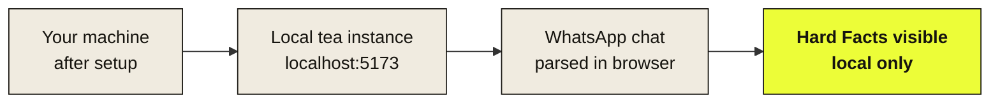

# Getting Started

This guide takes you from zero to a running tea instance with a parsed test chat in about 10 minutes. By the end, you will have:

- tea running on your local machine
- A WhatsApp chat parsed locally in your browser
- The Hard Facts module showing real numbers from that chat

> **Note:** This guide is for developers who want to run tea locally. If you only want to use tea, the [live version](https://www.spillteato.me) is the faster path. Come back here when you want to develop or contribute.

## What you will build



## Prerequisites

Before starting, make sure you have:

| Tool | Minimum version | Check with |
|---|---|---|
| Node.js | 18.0 | `node --version` |
| npm | 9.0 | `npm --version` |
| Git | any recent | `git --version` |
| An Anthropic API key (optional) | only for real AI reads | [console.anthropic.com](https://console.anthropic.com) |

If anything is missing:

- **Node.js + npm:** install the LTS version from [nodejs.org](https://nodejs.org)
- **Git:** install from [git-scm.com](https://git-scm.com), or on macOS run `xcode-select --install`
- **Anthropic API key:** only needed if you want real AI reads. Sign up at [console.anthropic.com](https://console.anthropic.com) and create a key.

> **Note:** By default the app runs in fixture mode. The AI modules then load sample results from `public/fixtures` and nothing is sent to an AI, so you can work on the whole app without a key.

## 1. Clone the repository

Open your terminal, navigate to where you want the project, then run:

```bash
git clone https://github.com/awyttrinx/chat-roentgen.git
cd chat-roentgen/roentgen
```

The application code lives in the `roentgen/` subfolder. The documentation lives in `docs/`, and the repository root contains strategy documents like the privacy audit and the DPIA.

> **Verify:** Run `ls`. You should see files like `package.json`, `src/`, and `index.html`.

## 2. Install dependencies

Inside the `roentgen/` folder:

```bash
npm install
```

This installs all packages from `package.json`. The first install can take a minute or two.

> **Verify:** A `node_modules/` folder appeared. No error messages in the terminal.

## 3. Configure your environment

Copy the environment template:

```bash
cp .env.example .env
```

That is all you need for fixture mode. `.env` already contains `VITE_ROENTGEN_ANALYZER=fixture`.

If you want real AI reads, open `.env` in your editor, set the analyzer to `api` and add your key from [console.anthropic.com](https://console.anthropic.com):

```
VITE_ROENTGEN_ANALYZER=api
ANTHROPIC_API_KEY=sk-ant-api03-xxxxxxxxxxxx
```

> **Caution:** Never commit `.env` to the repository. The `.gitignore` already excludes it, but always double-check before pushing.

## 4. Start the development server

```bash
npm run dev
```

You should see something like:

```
  VITE v5.4.21  ready in 500 ms

  ➜  Local:   http://localhost:5173/
```

Open `http://localhost:5173` in your browser. You should see tea's landing page with the upload area.

> **Verify:** The page loads, the `· local only` indicator is visible, and the upload area responds to hover.

## 5. Your first Hello World: parse a chat

Now the satisfying part. Let's make tea actually work end-to-end.

### Export a test chat from WhatsApp

On your phone:

1. Open any WhatsApp chat (pick a low-stakes one for testing)
2. Tap the contact name → scroll down → **Export Chat** → **Without Media**
3. Email the resulting file (`.txt` or `.zip`) to yourself, or save it to a cloud drive

> **Note:** tea currently parses WhatsApp `.txt` exports in German (`[DD.MM.YY, HH:MM:SS]`) and English (`MM/DD/YY, HH:MM AM/PM`) formats. Other formats (Telegram, Instagram) are on the roadmap but not yet supported.

### Upload it to your local tea

1. On `http://localhost:5173`, tick the house rules checkbox, then drop the `.txt` or `.zip` file onto the upload area
2. Wait for the parsing animation
3. Read the Hard Facts that appear

You should see numbers like message split, response times, and an activity heatmap. Everything you see came from your browser parsing the file. No data was sent anywhere.

> **Verify:** The `· local only` indicator stayed active throughout. Open your browser's DevTools → Network tab → filter for `xhr` or `fetch`. You should see no requests that carry chat data during parsing. That's the privacy guarantee, made visible.

In fixture mode you can click through the AI modules and see sample results. With `VITE_ROENTGEN_ANALYZER=api` and a key, the reads are real. If you set up Stripe with a test key (`sk_test_...`), use the test card `4242 4242 4242 4242` with any future date and any CVC.

## What you can do next

Now that tea runs locally, here are the most useful next steps:

- **[Tutorial](tutorial.md)**: walk through a complete user session, including the AI modules
- **[Concept](Concept.md)**: read the high-level architecture and design decisions
- **[Contributing](CONTRIBUTING.md)**: read this before submitting changes
- **Try a different chat**: patterns become clearer when you compare multiple conversations

## Troubleshooting

These are the five most common setup issues.

### `npm install` fails with permission errors (`EACCES`)

Your npm permissions are misconfigured.

- Follow [npm's official guide](https://docs.npmjs.com/resolving-eacces-permissions-errors-when-installing-packages-globally) to set up a user-writable npm prefix. Avoid `sudo npm install`, it causes more permission problems later.

### Port 5173 is already in use

Another process is using the default port. Run on a different port:

```bash
npm run dev -- --port 5174
```

Then open `http://localhost:5174` instead.

### The `.txt` file does not parse

The most common causes:

- The export includes media: re-export with **Without Media**
- The file extension was changed: tea accepts `.txt` and `.zip` from WhatsApp only
- The file is over 50 MB: export a shorter part of the chat
- The chat uses a non-supported format (e.g. Telegram `.json`)

If your WhatsApp `.txt` still does not parse, [open an issue](https://github.com/awyttrinx/chat-roentgen/issues) with a sanitized version of the file (names removed).

### AI modules return an authentication error

This only happens with `VITE_ROENTGEN_ANALYZER=api`. Your `ANTHROPIC_API_KEY` is missing or invalid. Open `.env`, check that the key matches your Anthropic console, and **restart the dev server**. Changes to environment variables do not reload on their own.

### Messages from one person are attributed to the other

This happens when a participant changed their display name during the chat. WhatsApp records the name at export time, but older messages may carry a different one. This is a known limitation of the WhatsApp export format, not a bug in tea.

## Need help?

If you're stuck on something not covered here, [open an issue on GitHub](https://github.com/awyttrinx/chat-roentgen/issues) with:

- What you were trying to do
- What you ran (exact commands)
- What error you got (full text or screenshot)

The more specific you are, the faster we can help.
